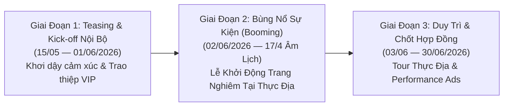

# KẾ HOẠCH TRUYỀN THÔNG TOÀN DIỆN (IMC PLAN)
## LỄ KHỞI ĐỘNG DỰ ÁN CÔNG VIÊN NGHĨA TRANG THIÊN PHÚC VĨNH HẰNG VIÊN (YÊN TỬ — QUẢNG NINH)

> **Dự án**: Công Viên Nghĩa Trang Thiên Phúc Vĩnh Hằng Viên  
> **Địa điểm**: Phường Uông Bí & Yên Tử, Tỉnh Quảng Ninh  
> **Đơn vị phát triển & hợp tác**: Sala Garden & CTCP Tập đoàn Faraland VN  
> **Chủ đề chính**: *“Gìn Giữ Hiếu Đạo — Kiến Tạo Vĩnh Hằng”*  
> **Thời gian sự kiện**: 09:00 – 11:00, Ngày 02/06/2026 (Nhằm ngày 17/4 Âm Lịch)  
> **Người lập kế hoạch**: Tạ Quốc Duy (Marketing Manager) & Trợ lý 🐱 Xu Xu  

---

## I. TỔNG QUAN DỰ ÁN & BỐI CẢNH CHIẾN DỊCH

### 1. Thông Tin Trọng Tâm Của Dự Án
- **Quy mô dự án**: ~32,54 ha, tổng vốn đầu tư hơn 450 tỷ đồng.
- **Vị trí phong thủy hiếm có**: Tọa lạc tại khu vực Bãi Dài (Uông Bí — Yên Tử, Quảng Ninh), kế cận Chùa Ba Vàng và dãy non thiêng Yên Tử – cái nôi của Phật giáo Trúc Lâm Đại Việt. Thế đất đắc địa *"Tựa Sơn Hướng Thủy"*, lưng tựa núi vững chãi, hướng nhìn thung lũng sinh thái thanh tịnh.
- **Mô hình phát triển**: Kế thừa chuẩn mực **Công viên hoa viên nghĩa trang sinh thái 5 sao** từ thương hiệu Sala Garden (dự án hoa viên sinh thái hàng đầu miền Nam), tích hợp đầy đủ công năng: mộ đơn, mộ đôi, hoa viên gia tộc, đền trình, nhà tang lễ, đài hóa thân hoàn vũ, trung tâm lưu tro cốt và công viên mặt nước ngũ hành.

### 2. Mục Tiêu Chiến Dịch Truyền Thông
1. **Mục tiêu nhận diện (Brand Awareness)**: Khắc sâu định vị *Thiên Phúc Vĩnh Hằng Viên* là công viên nghĩa trang sinh thái văn minh, cao cấp hàng đầu vùng Đông Bắc; xóa bỏ định kiến nghĩa trang u ám truyền thống.
2. **Mục tiêu B2B & Đại lý (Partner Enablement)**: Thúc đẩy khí thế bán hàng cho CTCP Tập đoàn Faraland VN và mạng lưới đại lý liên kết tại Quảng Ninh, Hải Phòng, Hà Nội.
3. **Mục tiêu chuyển đổi (Sales & Lead Generation)**: Thu hút 200+ khách mời VIP tham dự sự kiện khởi động; tạo tiền đề thu về 50+ hợp đồng đặt cọc giữ chỗ hoa viên gia tộc và đất sinh phần phong thủy trong tháng đầu tiên.

---

## II. CHÂN DUNG KHÁCH HÀNG & CÔNG CHÚNG MỤC TIÊU (TARGET AUDIENCE)

| Nhóm Đối Tượng | Đặc Điểm Nhân Khẩu & Hành Vi | Nhu Cầu & Động Lực (Insight) | Kênh Tiếp Cận Chủ Lực |
| :--- | :--- | :--- | :--- |
| **1. Khách VIP B2C (Gia đình Thượng lưu / Trưởng tộc)** | Độ tuổi 45 – 70; cư trú tại Quảng Ninh, Hải Phòng, Hà Nội; có tiềm lực tài chính lớn; coi trọng chữ Hiếu và phong thủy gia tộc. | Mong muốn chuẩn bị trước mảnh đất sinh phần phong thủy đẹp nơi đất Phật để ông bà, tổ tiên an nghỉ; tích phúc bền vững cho con cháu. | Thư mời thiệp VIP tận tay, tiếp đón thực địa cao cấp, Zalo riêng, báo chí uy tín (VnExpress, Dân Trí). |
| **2. Phật Tử & Người Yêu Mến Đất Thiêng Yên Tử** | Mọi lứa tuổi; thường xuyên hành hương Chùa Ba Vàng, Yên Tử; tin vào luật nhân quả, sự an lạc tâm hồn. | Mong muốn cội nguồn tâm linh thanh tịnh, nghe kinh kệ sớm hôm, chăm sóc hương khói chu đáo trọn đời. | Video ngắn Phật giáo, Reels/TikTok câu chuyện hiếu đạo, cộng đồng Phật tử, kênh truyền thông Chùa. |
| **3. Đối Tác Phân Phối B2B & Đại Lý (Faraland VN)** | Ban lãnh đạo sàn, Giám đốc khối, Trưởng phòng kinh doanh (TPKD), chuyên viên môi giới BĐS cao cấp. | Cần thông tin pháp lý minh bạch, bảng giá giai đoạn 1 hấp dẫn, chính sách hoa hồng rõ ràng và công cụ bán hàng (POSM/Kit) sắc bén. | Hội nghị Kick-off, Lễ ký kết phân phối chiến lược, tài liệu Sales Kit in ấn chuyên nghiệp, Zalo Group. |

---

## III. THÔNG ĐIỆP CỐT LÕI & 5 TRỤ CỘT TRUYỀN THÔNG

### Thông Điệp Chủ Đạo (Key Message):
> **“GÌN GIỮ HIẾU ĐẠO — KIẾN TẠO VĨNH HẰNG”**  
> *Nơi linh khí đất Phật Yên Tử giao hòa cùng quy chuẩn hoa viên sinh thái 5 sao, mang lại phúc lộc trường tồn cho muôn đời sau.*

### 5 Trụ Cột Nội Dung (Content Pillars):
1. **Vị Trí Phong Thủy Đắc Địa**: Vùng đất Phật linh thiêng Yên Tử – Chùa Ba Vàng, thế đất tựa sơn hướng thủy vượng khí sinh tài.
2. **Cảnh Quan Sinh Thái Tinh Tế**: Quy hoạch chuẩn resort sinh thái, công viên cây xanh, hồ cảnh quan thanh lọc tâm hồn.
3. **Dịch Vụ Chuẩn Mực Tận Tâm**: Vận hành đồng bộ theo chuẩn Sala Garden; quản lý mộ phần trọn đời, nghi lễ tâm linh chu toàn 365 ngày/năm.
4. **Tâm An Phúc Trọn Bền Vững**: Báo hiếu đấng sinh thành từ sớm (đất sinh phần), con cháu thanh thản, gia tộc hiển vinh.
5. **Trường Tồn Cùng Thời Gian**: Pháp lý quy hoạch bài bản, hạ tầng vĩnh cửu, giá trị gia tăng bền vững.

---

## IV. LỘ TRÌNH TRIỂN KHAI THEO 3 GIAI ĐOẠN (TIMELINE & PHASING)

### 1. Giai Đoạn 1: Teasing & Kích Hoạt Đại Lý (Trước Sự Kiện: 15/05 – 01/06/2026)
- **Mục tiêu**: Tạo sự tò mò trong cộng đồng BĐS miền Bắc; cá nhân hóa và phát hành trọn vẹn thiệp mời VIP.
- **Hoạt động cụ thể**:
  - **Phát hành Thiệp Mời Cá Nhân Hóa**: Thiết kế và in ấn thiệp mời cao cấp mạ nhũ vàng gửi tận tay các vị khách quý (như mẫu gửi *Ông Đinh Bá Mạnh — TPKD*, *Ông Nguyễn Tất Thắng — PTKD Tập đoàn Faraland VN*).
  - **Teaser Video 30s – 45s**: Thước phim flycam non thiêng Yên Tử lúc bình minh, lồng ghép tiếng chuông chùa thanh thoát và lời dẫn dắt về *"Một chốn an nghỉ tựa chốn bồng lai sắp khởi sinh"*.
  - **PR Báo chí đợt 1**: 2 bài viết phân tích xu hướng dịch chuyển sang công viên nghĩa trang sinh thái tại Quảng Ninh trên *Báo Xây Dựng* và *Báo Quảng Ninh*.
  - **Hội nghị nội bộ Faraland & Sala Garden**: Họp triển khai công tác đón tiếp khách, phân luồng xe đưa đón từ Hà Nội/Hải Phòng về Uông Bí.

### 2. Giai Đoạn 2: Bùng Nổ Sự Kiện (Ngày 02/06/2026 — 17/4 Âm Lịch)
- **Mục tiêu**: Khắc sâu dấu ấn trang trọng, khẳng định tầm vóc dự án; ký kết hợp tác phân phối chiến lược.
- **Khung thời gian sự kiện (09:00 – 11:00)**:
  - **08:30 – 09:00**: Đón tiếp khách quý tại sảnh nhà đón tiếp dự án; trà đạo thanh tịnh và nhạc giao hưởng thiền tịnh.
  - **09:00 – 09:15**: Nghi thức chào cờ, niệm Phật cầu an và tuyên bố lý do khai mạc.
  - **09:15 – 09:35**: Đại diện Chủ đầu tư & Sala Garden chia sẻ tâm huyết kiến tạo dự án chuẩn sinh thái 5 sao tại miền đất Phật.
  - **09:35 – 09:50**: Nghi thức bấm nút **KHỞI ĐỘNG DỰ ÁN THIÊN PHÚC VĨNH HẰNG VIÊN** & Nghi lễ đặt đá tâm linh.
  - **09:50 – 10:10**: Lễ ký kết phân phối chiến lược cùng **CTCP Tập đoàn Faraland VN**.
  - **10:10 – 10:45**: Hướng dẫn quan khách tham quan thực địa vị trí phong thủy Bãi Dài, view ngắm Chùa Ba Vàng.
  - **10:45 – 11:00**: Tiệc chay thanh tịnh tri ân khách quý và trao tặng quà tặng phong thủy lưu niệm.
- **Tác nghiệp truyền thông**: Livestream Fanpage, flycam quay toàn cảnh, đội ngũ phóng viên báo đài tác nghiệp trực tiếp.

### 3. Giai Đoạn 3: Chuyển Hóa & Bứt Phá Doanh Số (03/06 – 30/06/2026)
- **Mục tiêu**: Duy trì sức nóng truyền thông, đưa khách tiềm năng đi tham quan thực tế và chốt đơn đặt cọc.
- **Hoạt động cụ thể**:
  - **Phóng sự Highlight & Video Recap**: Dựng video phóng sự 2–3 phút ghi lại toàn cảnh sự kiện trang nghiêm, phát sóng đa nền tảng (Facebook, TikTok, YouTube).
  - **Báo chí lan tỏa đợt 2**: 3 bài PR điểm tin sự kiện khởi động thành công trên *VnExpress, Dân Trí, Vietnamnet*.
  - **Chiến dịch Performance Ads Đa Kênh**:
    - Ngân sách dự kiến: 150 – 200 triệu VNĐ/tháng.
    - Facebook Lead Ads nhắm tệp 45+ tại Quảng Ninh, Hải Phòng, Hà Nội với thông điệp: *"Sở hữu khuôn viên gia tộc đắc địa nơi đất Phật Yên Tử — Ưu đãi giai đoạn 1"*.
    - Google Search Ads: Đấu thầu các từ khóa *"nghĩa trang Yên Tử"*, *"đất nghĩa trang Quảng Ninh"*, *"công viên nghĩa trang Uông Bí"*, *"hoa viên sinh thái miền Bắc"*.
  - **Chương trình "Hành Trình Tri Ân & Thăm Đất Phật"**: Tổ chức xe đưa đón khách hàng VIP cuối tuần kết hợp viếng Chùa Ba Vàng / Yên Tử và tham quan dự án Thiên Phúc Vĩnh Hằng Viên.

---

## V. MA TRẬN KÊNH TRUYỀN THÔNG (CHANNEL MATRIX)

| Kênh Triển Khai | Định Dạng Nội Dung | Tần Suất / Khối Lượng | Mục Tiêu Chính |
| :--- | :--- | :--- | :--- |
| **Kênh Mạng Xã Hội (Facebook, TikTok, YouTube)** | Video ngắn 60s, phóng sự trải nghiệm, hình ảnh 3D quy hoạch, bài viết phân tích phong thủy đất Phật. | 3 – 4 bài/tuần; 20+ video ngắn trong tháng. | Xây dựng độ phủ tự nhiên, tương tác người dùng, khơi gợi lòng hiếu đạo. |
| **Báo Chí Uy Tín (PR)** | Bài viết chuyên sâu, phỏng vấn chuyên gia phong thủy & đại diện Sala Garden / Faraland. | 5 – 7 bài báo lớn (Báo Quảng Ninh, VnExpress, Dân Trí, Báo Xây Dựng). | Định vị uy tín pháp lý, sự nghiêm túc và đẳng cấp của dự án. |
| **Ấn Phẩm Thực Địa (POSM & In Ấn)** | Thiệp mời bìa cứng ép nhũ, Backdrop lễ khởi động, Standee giới thiệu 5 giá trị, Brochure Sales Kit khổ lớn. | Theo file vector thiết kế chuẩn [In ấn Phường Yên Tử.eps](file:///Users/Admin/Documents/Ta%CC%A3%20Quo%CC%82%CC%81c%20Duy%20Portolio/Tho%CC%82ng%20tin%20du%CC%A3%CC%81%20a%CC%81n/sala_garden_new/In%20a%CC%82%CC%81n%20Phu%CC%9B%CC%9Bo%CC%80ng%20Ye%CC%82n%20Tu%CC%9B%CC%89.eps). | Tạo sự trang trọng, uy nghiêm và đẳng cấp tại khu vực sự kiện. |
| **Digital Performance Ads** | Quảng cáo biểu mẫu tìm kiếm khách hàng (Lead Ads), Google Search, Google Display Network. | Vận hành liên tục 30 ngày sau sự kiện. | Thu về 60 – 80 khách hàng tiềm năng có nhu cầu mua đất sinh phần / gia tộc. |
| **Direct Sales & B2B Kit** | Bộ công cụ tư vấn: Bảng tính phong thủy theo tuổi, sa bàn phối cảnh, cẩm nang nghi lễ hiếu đạo. | Cung cấp đầy đủ cho 100% chuyên viên kinh doanh Faraland VN. | Hỗ trợ tư vấn chốt giao dịch nhanh chóng và chuẩn xác. |

---

## VI. DỰ TOÁN NGÂN SÁCH TRUYỀN THÔNG & SỰ KIỆN (DỰ KIẾN)

| Hạng Mục Chi Tiết | Nội Dung Công Việc | Chi Phí Dự Kiến (VNĐ) | Tỷ Trọng (%) |
| :--- | :--- | :---: | :---: |
| **1. Tổ Chức Sự Kiện Lễ Khởi Động** | Rạp sự kiện trang trọng, âm thanh, ánh sáng, màn hình LED, bàn ghế đại biểu, tiệc trà đạo & tiệc chay thanh tịnh, xe đưa đón khách VIP. | 180.000.000 | 40% |
| **2. Thiết Kế & Sản Xuất POSM, In Ấn** | In thiệp mời cao cấp ép kim mạ nhũ vàng, catalogue bán hàng, backdrop, standee, kỷ yếu quà tặng lưu niệm đất Phật. | 50.000.000 | 11% |
| **3. Sản Xuất Nội Dung & Media** | Ekip quay flycam, chụp ảnh, sản xuất 1 video giới thiệu dự án 3D, 1 teaser và 1 phóng sự recap sự kiện chất lượng 4K. | 60.000.000 | 13% |
| **4. Báo Chí & Quan Hệ Công Chúng (PR)** | Booking bài viết trên Báo Quảng Ninh, VnExpress, Dân Trí, Báo Xây Dựng và Đài truyền hình địa phương. | 70.000.000 | 16% |
| **5. Quảng Cáo Số (Digital Ads - Tháng 1)** | Quảng cáo Facebook Lead, Google Search, Zalo Ads nhắm đối tượng khách hàng mục tiêu Quảng Ninh, Hải Phòng, Hà Nội. | 90.000.000 | 20% |
| **TỔNG DỰ TOÁN TRUYỀN THÔNG & RA MẮT** | **Đảm bảo đồng bộ và hiệu quả tối đa** | **450.000.000 VNĐ** | **100%** |

---

## VII. CHỈ SỐ ĐO LƯỜNG HIỆU QUẢ (KPIs CAM KẾT)

1. **Về Sự Kiện**:
   - 100% khách mời VIP (200+ đại biểu, đối tác Faraland, khách mời danh dự) nhận thiệp mời trang trọng trước sự kiện ít nhất 5 ngày.
   - Tỷ lệ tham dự thực tế đạt tối thiểu 85–90% lượng thư mời phát ra.
2. **Về Truyền Thông Lan Tỏa**:
   - Đạt trên 500.000 lượt hiển thị và tiếp cận trên các nền tảng số.
   - Ít nhất 6 bài báo chính thống đưa tin về sự kiện khởi động.
   - Đạt hơn 50.000 lượt xem video recap và hình ảnh không gian sự kiện.
3. **Về Hiệu Quả Kinh Doanh & Sales Enablement**:
   - Thu về tối thiểu 60+ khách hàng tiềm năng chất lượng cao (Leads) quan tâm đất mộ sinh phần và hoa viên gia tộc.
   - Tối thiểu 20–30 lượt khách đăng ký tour trải nghiệm thực tế vào các dịp cuối tuần sau sự kiện.
   - Hỗ trợ Faraland VN chốt tối thiểu 15–20 giao dịch đặt cọc giữ chỗ ngay trong tháng khởi động đầu tiên.
